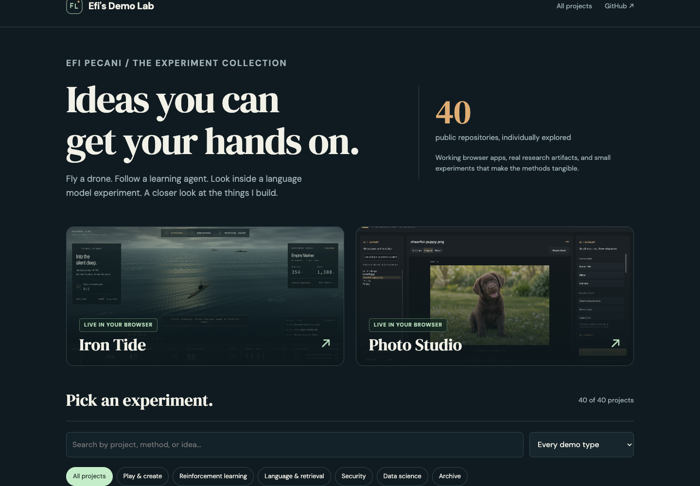

# Efi's Demo Lab

**A closer look at every public repository: working browser apps, original research artifacts, and interactive explanations.**

[Explore the gallery](https://eforus-overseer.github.io/demo-lab/) · [GitHub profile](https://github.com/eforus-overseer)



The collection contains **40 individual project pages**, reviewed against the source repositories. Each page explains the method, links to the original source and notebooks, and states what its demo actually does.

## What you can try

- **Original browser apps:** launch Iron Tide and PROP//WASH in the gallery, or open the existing Photo Studio and Empathy CAPTCHA sites.
- **Recorded agents:** compare real repository recordings for LunarLander, MiniGrid, Flappy Bird, and rotorenv.
- **Working explanations:** Count-Min Sketch, BM25 retrieval, K-means, least-squares regression, character n-gram perplexity, second-order Markov generation, word counting, portfolio variance, Lorenz curves, and classification metrics.
- **Original research:** inspect saved plots and methods from the notebooks, with links to their source.
- **Visual Vocabulary:** browse all 62 original SVG charts and their Matplotlib scripts.
- **MCP catalog:** browse all 37 actual Octo Browser tool declarations without connecting an account.
- **Archive pages:** the profile, legacy photo editor, and placeholder repositories have honest descriptions of their current state.

Browser explainers use small original or synthetic teaching inputs. They are distinct from the repositories' trained models and published evaluations. Pages describe those limits explicitly.

Private repositories are excluded. Raw datasets, credentials, emails, individual mobility traces, and respondent records are not copied into the gallery.

## Run locally

```bash
python3 -m http.server 5175 --bind 127.0.0.1 --directory dist
```

Open **http://127.0.0.1:5175/**. The gallery is static HTML, CSS, and JavaScript; no framework build or account is required. The original games use WebGL and their existing external dependencies.

## Maintain the collection

- `content/projects.py`: individually written descriptions, walkthroughs, caveats, and selected artifacts.
- `content/manifest.json`: versioned page records and source URLs.
- `web/`: shared styling and browser interactions.
- `tools/build.py`: regenerates the static routes from the manifest.
- `tools/validate.py`: checks routes, artifacts, and local links before deployment.
- `tools/audit_repos.py`: optional GitHub CLI audit of public repositories. Local audit output is ignored.
- `tools/fetch_assets.py`: collects explicitly selected public figures, recordings, and app sources.
- `dist/`: complete, versioned GitHub Pages artifact.

To edit existing pages, update the manifest and shared source, then run:

```bash
python3 tools/build.py
python3 tools/validate.py
```

Pushing to `main` validates and publishes the static artifact using GitHub Pages.

## Credit

Projects are by Efi Pecani and the collaborators named in their original repositories. Every figure links to its source. The gallery preserves original chart content and recordings rather than assigning new benchmark claims to browser examples.

See [ARTIFACTS.md](ARTIFACTS.md) for repository-level provenance and licensing scope. The generated cheerful puppy in Photo Studio is identified as AI-generated in that source project.
